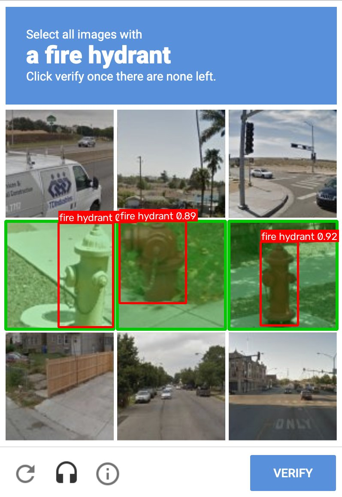
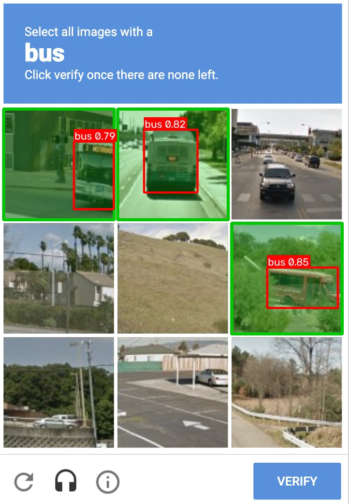

# yolov3-recaptcha

> **Archived (November 2026).** This is the final version, kept for reference and no longer maintained.

A proof of concept that solves reCAPTCHA v2 image challenges with object detection. It started in 2019
with YOLOv3. The final version uses Ultralytics YOLO26 and clicks the tiles itself.

<p align="center">
  
  &nbsp;
  
</p>

Red boxes are YOLO26 detections; green tiles are the ones the solver clicks.

## How it works

`selenium_demo.py` runs against [Google's reCAPTCHA demo page](https://www.google.com/recaptcha/api2/demo):

1. Open the page in Chrome and tick "I'm not a robot".
2. If an image challenge appears, read the prompt ("Select all images with **buses**") and map it to a
   COCO class (`bus`).
3. Screenshot the grid and run YOLO26 on it:
   - **3x3 grids** are nine separate photos, so each tile is checked on its own.
   - **4x4 grids** are one photo cut into squares, so the whole photo is checked once. A square is clicked
     when a detection covers at least 10% of it.
4. Click the matching tiles. In "click verify once there are none left" rounds, clicked tiles are replaced
   by new photos. The solver checks the new photos and keeps clicking until none match.
5. Press Verify. Repeat for the next round, reloading prompts YOLO can't answer. Once the checkbox is
   ticked, submit the demo form.

Every screenshot the solver acts on is saved to `out/` with its detections marked.

## Running it

You need [uv](https://docs.astral.sh/uv/) and, for the live demo, Google Chrome. Selenium downloads the
matching ChromeDriver automatically.

```sh
uv sync                    # Python 3.13, CPU-only PyTorch, Ultralytics, Selenium
uv run image_demo.py       # offline: marks the tiles on the two screenshots in docs/, writes to out/
uv run selenium_demo.py    # live: opens Chrome on Google's demo page and tries to solve it
uv run pytest              # checks tile picking against the bundled screenshots
```

`yolo26s.pt` (20 MB) downloads on first run. You can also run the offline demo on your own screenshot of
a full 3x3 challenge: `uv run image_demo.py shot.png "traffic lights"`.

## Why it's still called yolov3-recaptcha

The 2019 version was a TensorFlow 2.0 port of YOLOv3 with Darknet's 237 MB COCO weights. It found objects
in a screenshot of the challenge but never clicked anything: clicking, prompt mapping and multi-round
challenges were on its TODO list. Dependabot spent the next few years bumping TensorFlow, Pillow and
protobuf around code that no longer ran on current Python.

The final revision (2026) completes that TODO list instead of patching it:

- **YOLO26 via Ultralytics** replaces the hand-written YOLOv3. It is a smaller download and more accurate,
  and there is no TensorFlow or manual weights download.
- **Selenium 4** clicks tiles, follows refilling grids and presses Verify. Selenium Manager handles the
  driver.
- **uv** with a lockfile replaces `requirements.txt`. All known vulnerabilities in the dependency tree
  were fixed when it was archived.

The repository keeps its name so existing links still work. The original code is tagged
[`v1-tensorflow-yolov3`](https://github.com/ozankaraali/yolov3-recaptcha/tree/v1-tensorflow-yolov3).

## Why this doesn't beat reCAPTCHA in 2026

Recognizing buses was never the hard part, and by now it is a solved problem. In 2023, Searles et al.
found that published bots solve image CAPTCHAs faster and more accurately than the 1,400 people they
tested [1]. In 2024, an ETH
Zürich team solved 100% of reCAPTCHA v2 image challenges with a fine-tuned YOLOv8 [2]. The image puzzle
is a speed bump. reCAPTCHA decides who gets through elsewhere:

- **The score comes first.** Before the checkbox is clicked, reCAPTCHA's obfuscated JavaScript has
  already profiled the browser. It looks at fingerprints (canvas, WebGL, fonts, audio, screen and
  hardware details), Google cookies and account history, IP reputation, and how the mouse and keyboard
  were used. A trusted session gets the green tick without a puzzle. An untrusted one gets puzzles, and
  the score decides how many.
- **Correct answers aren't enough.** A low-scoring session can answer every round correctly and still get
  another round, slower fading tiles, or "Try again later: your computer or network may be sending
  automated queries". The ETH team found that bots and people needed about the same number of rounds,
  and that reCAPTCHA v2 leans heavily on cookies and browser history to tell them apart [2].
- **Automation is visible.** A Selenium-driven Chrome reports `navigator.webdriver = true`, as the
  WebDriver standard requires. It also starts from a fresh profile with no history, which is exactly what
  the risk engine looks for. This demo makes no attempt to hide either.
- **Often there is no puzzle at all.** reCAPTCHA v3 and reCAPTCHA Enterprise score every request in the
  background and leave the decision to the website. Cloudflare Turnstile and Private Access Tokens work
  the same way. A detector has nothing to look at.

Depending on your network and browser history, expect `selenium_demo.py` to end in one of three ways:
round after round of challenges, a "try again later" block, or now and then a pass on the demo page.
That is what the project now documents: object detection turned the image challenge into a formality,
and CAPTCHAs moved on to judging the browser instead of the answer.

## Limitations

- Only prompts that map to COCO classes are attempted: bicycles, boats, buses, cars/taxis, fire hydrants,
  motorcycles and traffic lights. Crosswalks, stairs, chimneys, bridges, palm trees, mountains and tractors
  are reloaded. An open-vocabulary model such as YOLOE could take the prompt text directly, at the cost of
  a CLIP text encoder.
- The 4x4 square picking uses bounding boxes, not masks, so it over-selects around object edges.
- The page selectors match reCAPTCHA's markup as of late 2026, and Google changes it without notice.

Use this only on pages you own or on Google's demo page. Automating CAPTCHAs on other sites may break
their terms of service.

## References

1. A. Searles et al., "An Empirical Study & Evaluation of Modern CAPTCHAs", USENIX Security 2023.
   [arXiv:2307.12108](https://arxiv.org/abs/2307.12108)
2. A. Plesner, T. Vontobel, R. Wattenhofer, "Breaking reCAPTCHAv2", COMPSAC 2024.
   [arXiv:2409.08831](https://arxiv.org/abs/2409.08831)

## Credits and license

The code in this repository is MIT licensed. It depends on [Ultralytics](https://github.com/ultralytics/ultralytics)
and its YOLO26 weights, which are AGPL-3.0; distributing a combined work brings their terms into play.

The 2019 version built on [YunYang1994's TensorFlow 2.0 YOLOv3](https://github.com/YunYang1994/TensorFlow2.0-Examples),
[Igor Savinkin's Selenium checkbox approach](https://stackoverflow.com/questions/32249190/improve-recaptcha-2-0-solving-automation-script-selenium/32415298)
and [Joseph Redmon's YOLOv3](https://pjreddie.com/darknet/yolo/).
